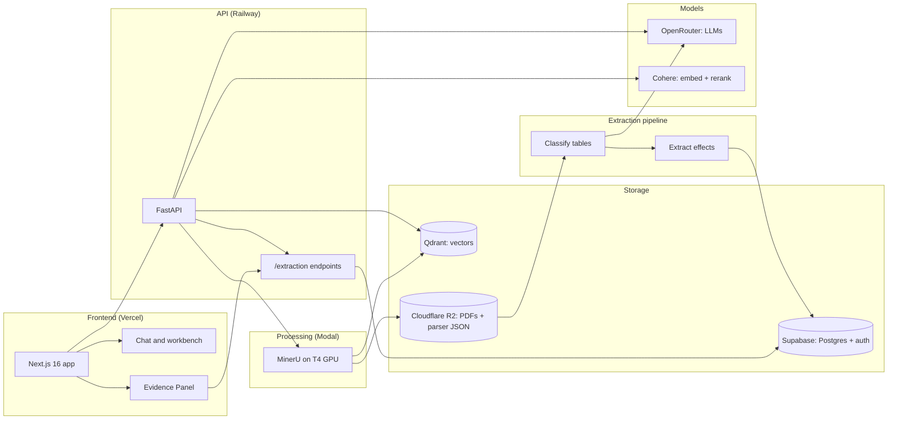

<p align="center">
  
  
  
</p>

<h1 align="center">3ie Evidence Assistant</h1>

<p align="center">
  <strong>Citation-grounded question answering and effect-size extraction for impact evaluation literature</strong><br>
  <sub>Formerly <em>DevChat</em>. The rename is in progress, see <a href="docs/RENAME_PLAN.md">docs/RENAME_PLAN.md</a>.</sub>
</p>

<p align="center">
  <a href="https://dev-chat-frontend.vercel.app/">Live app</a> •
  <a href="#status-november-2026">Status</a> •
  <a href="#features">Features</a> •
  <a href="#architecture">Architecture</a> •
  <a href="#quick-start">Quick start</a> •
  <a href="docs/ROADMAP.md">Roadmap</a>
</p>

---

## What it is

The 3ie Evidence Assistant is a multi-tenant retrieval-augmented generation (RAG) platform for researchers and
evidence synthesis teams. Users upload study PDFs into their own projects and ask questions across them. Answers
cite the source passage, and each citation opens the PDF at the right page.

A separate extraction pipeline reads the results tables in each study and pulls out treatment effects
(coefficients, standard errors, p-values, sample sizes), which the API serves to the chat and the Evidence Panel.

---

## Status (November 2026)

| Area | State |
| ---- | ----- |
| Deployment | Frontend on Vercel, API on Railway, PDF processing on Modal. Last commit: April 2026 |
| RAG answers | Working. Faithfulness 66.5% on a 5-query baseline from January 2026. Target 70%+ |
| Extraction pipeline | 12,366 rows from 1,115 results tables in 86 studies. **Accuracy is self-measured** (no human ground truth yet) |
| Evaluation | A human-keyed harness from the TVET parser bake-off is being ported. See the TVET Transfer section of the [Roadmap](docs/ROADMAP.md) |
| Models | Defaults are 2024-era (`gpt-4o-mini`, `gpt-4o`, Cohere `rerank-v3.5`). Upgrade plan in [Roadmap: SOTA Upgrade](docs/ROADMAP.md#-sota-upgrade-november-2026) |

> **Honest disclosure:** extraction accuracy has not been validated against human coding. There are no regression
> tests and no systematic prompt methodology yet. The roadmap's
> [Critical Gaps](docs/ROADMAP.md#-critical-gaps-must-fix-before-any-other-improvement) section lists what is
> missing and the TVET Transfer section lists how it will be closed.

---

## Features

### Ingestion

- **MinerU parsing on a Modal T4 GPU**: text, tables (as HTML), figures and equations
- **Eight-step table post-processing**: removes empty tables, figures and text fragments misread as tables, merges
  tables split across pages, grafts orphan headers, and repairs captions from the List of Tables
- **Contextual retrieval**: each chunk is prefixed with an LLM-written summary of its place in the document
- **Parent-child chunking**: 256-token chunks for search, 1,024-token parents for context
- **Metadata enrichment** from Crossref and OpenAlex, and **study design classification** (22 designs)
- **Bibliography import** (RIS, BibTeX, CSV) and **Zotero sync**

### Retrieval

- **Hybrid search** in Qdrant: Cohere `embed-v4.0` dense vectors (1,536 dimensions) plus BM25-style sparse vectors
- **Quantisation**: binary by default (about 32× smaller), scalar or none as options
- **Query processing**: multi-query RAG-Fusion with reciprocal rank fusion, query decomposition and step-back
  prompting. HyDE is implemented but **disabled**, because it lowered faithfulness in testing
- **Cohere reranking** (`rerank-v3.5`), MMR diversity filtering and lost-in-the-middle reordering
- **Caching**: embedding cache and a semantic cache for near-identical questions

### Synthesis

- **Claim Ledger**: a two-pass synthesis that extracts claims and binds each one to a source passage
- **Inline citations** in `[Author, Year, p.X]` form, linked to an in-app PDF viewer with highlighting
- **Post-hoc verification** with MiniCheck natural-language inference
- **Per-project settings**: model choice, domain instructions, custom prompts with a ten-version history

### Extraction pipeline

```bash
python -m extraction_pipeline.batch.classify   # classify every table: RESULTS / DESCRIPTIVE / SKIP
python -m extraction_pipeline.batch.extract    # extract values from RESULTS tables
python -m extraction_pipeline.pipeline --study_id 121058356   # one study end to end
```

| Stage | Module | What it does |
| ----- | ------ | ------------ |
| 1. Post-process | `extraction_pipeline/postprocessing/mineru.py` | Removes MinerU artefacts |
| 2. Caption repair | `extraction_pipeline/postprocessing/lot_parser.py` | Repairs captions from the List of Tables |
| 3. Classify | `extraction_pipeline/classification/` | Rules first, then an LLM classifier with few-shot examples |
| 4. Extract | `extraction_pipeline/extraction/` | Handlers for five table layouts, plus prose and figure fallbacks |
| 5. Store | `extraction_pipeline/adapters/supabase_loader.py` | Loads the `extracted_estimates` table in Supabase |

Results are served by ten endpoints under `/extraction/*` ([api/routes/extraction.py](api/routes/extraction.py)).
Full detail is in [extraction_pipeline/README.md](extraction_pipeline/README.md).

### Admin panel

Overview (usage, costs, projections), users and projects, quality (Langfuse experiments and baselines),
documents, processing jobs, and a metadata editor with a PDF viewer.

---

## Architecture



### Tech stack

| Layer | Technology |
| ----- | ---------- |
| Frontend | Next.js 16, React 19, TypeScript, Tailwind CSS 4, shadcn/ui |
| API | FastAPI, Python 3.12, Pydantic v2 |
| Auth and database | Supabase (Postgres, JWT, row-level security) |
| Vectors | Qdrant Cloud (dense + sparse, binary quantisation) |
| Embeddings | Cohere `embed-v4.0`, 1,536 dimensions |
| Reranking | Cohere `rerank-v3.5` |
| LLMs | OpenRouter. Defaults `openai/gpt-4o-mini` (fast) and `openai/gpt-4o` (reasoning) |
| PDF processing | MinerU 2.6+ on Modal (T4 GPU) |
| Storage | Cloudflare R2 |
| Observability | Langfuse |

---

## Quick start

### Prerequisites

Accounts for Supabase, Qdrant Cloud, Modal, OpenRouter, Cohere and Cloudflare R2, plus Python 3.12 and Node 20+.

### API

```bash
git clone https://github.com/lsempe77/3ie-evidence-assistant.git
cd 3ie-evidence-assistant

python -m venv .venv
source .venv/bin/activate        # Windows: .venv\Scripts\activate
pip install -e .

# Create .env with the keys listed in src/config/settings.py
# (there is no .env.example yet)

uvicorn api.server:app --reload --port 8000
```

### Frontend

```bash
cd frontend
npm install
npm run dev
```

### Modal worker

```bash
python -m modal deploy infrastructure/modal_mineru.py
```

Use `python -m modal`, not the `modal` executable, which exits silently on some Windows set-ups. The Modal
workspace that owns the deployed app is `lsempe77`. Activate that profile before deploying.

---

## Project structure

```
.
├── api/                    FastAPI app
│   ├── routes/             chat, rags, extraction, zotero, health, admin/
│   └── schemas/            Pydantic models
├── src/                    Core library
│   ├── agents/             query orchestration
│   ├── retrieval/          hybrid retriever, reranker, query processing, HyDE
│   ├── generation/         Claim Ledger, synthesiser, post-hoc verifier, router
│   ├── ingestion/          chunking, contextualiser, embeddings, indexer, metadata
│   ├── extraction/         extraction schemas
│   ├── auth/ database/ config/ utils/
├── extraction_pipeline/    Effect-size extraction
│   ├── core/ parsing/ classification/ extraction/
│   ├── enrichment/ postprocessing/ batch/ adapters/
│   └── pipeline.py         orchestration
├── infrastructure/         Modal app (modal_mineru.py, modal_lib/)
├── frontend/               Next.js app (app/, components/, lib/)
├── supabase/migrations/    SQL migrations
├── evaluation/             evaluation scripts and baselines
├── tests/                  pytest suite
├── scripts/                maintenance utilities
├── tutorials/              learning series (Part 1 written)
└── docs/                   roadmap, evaluation, extraction, Sphinx docs
```

---

## Documentation

| Document | Contents |
| -------- | -------- |
| [SETUP_TRACKER.md](SETUP_TRACKER.md) | Implementation status and configuration |
| [docs/ROADMAP.md](docs/ROADMAP.md) | Priorities, including the TVET Transfer and SOTA Upgrade plans |
| [docs/RENAME_PLAN.md](docs/RENAME_PLAN.md) | Steps for the DevChat → 3ie Evidence Assistant rename |
| [docs/EVALUATION.md](docs/EVALUATION.md) | Citation-quality evaluation framework and baselines |
| [docs/EXTRACTION.md](docs/EXTRACTION.md) | Extraction pipeline reference |
| [docs/MINERU_POSTPROCESSING_PLAN.md](docs/MINERU_POSTPROCESSING_PLAN.md) | The eight post-processing steps |
| [tutorials/README.md](tutorials/README.md) | Learning series. Part 1 (posts 1–10) is written, Parts 2–5 are planned |
| [CHANGELOG.md](CHANGELOG.md) | Version history (last entry January 2026) |

---

## Acknowledgements

Built by [3ie](https://www.3ieimpact.org/), the International Initiative for Impact Evaluation.
